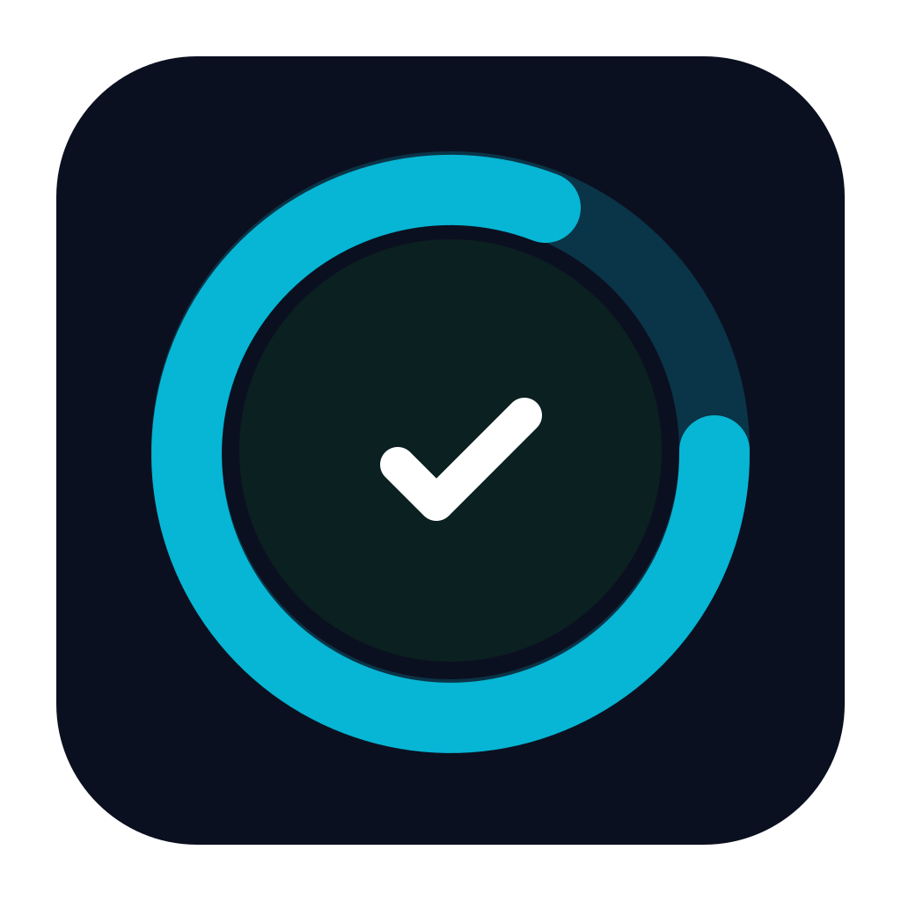

<!--suppress HtmlDeprecatedAttribute -->
<p align="center">
  
</p>

<!--suppress HtmlDeprecatedAttribute -->
<h1 align="center">HabitTracker — социальный трекер привычек</h1>

<!--suppress HtmlDeprecatedAttribute -->
<p align="center">
  Отмечай привычки в одиночку или с друзьями, создавай групповые привычки и устраивай челленджи. 
  Напоминания, офлайн-поддержка, синхронизация через Firestore и удобный современный UI на Jetpack Compose.
</p>

<!--suppress HtmlDeprecatedAttribute -->
<p align="center">
  <a href="https://developer.android.com"></a>
  <a href="https://kotlinlang.org"></a>
  <a href="https://developer.android.com/jetpack/compose"></a>
  <a href="https://dagger.dev/hilt/"></a>
  <a href="https://kotlinlang.org/docs/coroutines-overview.html"></a>
  <a href="https://firebase.google.com"></a>
</p>

---

## Содержание
- [О проекте](#о-проекте)
- [Основные возможности](#основные-возможности)
- [Скриншоты](#скриншоты)
- [Стек технологий](#стек-технологий)
- [Архитектура и структура](#архитектура-и-структура)
- [Документация в репозитории](#документация-в-репозитории)
- [Быстрый старт](#быстрый-старт)
- [Тестирование](#тестирование)
- [Безопасность и приватность](#безопасность-и-приватность)
- [Производительность](#производительность)
- [Дорожная карта (Roadmap)](#дорожная-карта-roadmap)
- [Как контрибьютить](#как-контрибьютить)
- [Лицензия](#лицензия)
- [Благодарности](#благодарности)

## О проекте
HabitTracker — мобильное приложение для Android, которое помогает формировать и отслеживать привычки как индивидуально, так и в группах с друзьями. 
Делайте прогресс вместе: приглашайте друзей, получайте напоминания, отмечайте выполнение и смотрите общую статистику.

Проект построен с упором на:
- современный UI/UX (Jetpack Compose, Material 3, анимации);
- надежную офлайн-поддержку (Room) и синхронизацию (Outbox → Firestore);
- социальные функции (друзья, приглашения, групповые привычки);
- уведомления (локальные напоминания и push через FCM).

## Основные возможности
- Личные и групповые привычки (поддержка участников, лимитов, invite-code, публичные/приватные группы).
- Приглашения в привычки: отправка, принятие/отклонение, присоединение по коду.
- Напоминания о привычках: WorkManager + корректная работа с разрешением уведомлений (Android 13+).
- Система друзей: поиск, заявки, принятие/отклонение, список друзей.
- Push-уведомления (FCM): приглашения, события групповых привычек, активности друзей.
- Офлайн-режим: Room-кэш, оптимистичные апдейты, Outbox-синхронизация с Firestore.
- Аутентификация Google (Credential Manager API).
- Улучшенный UX: валидация формы в реальном времени, Snackbar, UNDO после удаления, плавные анимации.

Статус модулей:
- Челленджи: в разработке (будут соревнования между друзьями).
- Геймификация (очки, уровни, достижения): в разработке.

## Скриншоты
Скриншоты будут добавлены позже.

Предлагаемая структура:
```
art/screenshots/
  habits_list.png
  add_edit_habit.png
  group_habit_detail.png
  friends_tabs.png
```

## Стек технологий
- Язык: Kotlin, Coroutines + Flow
- UI: Jetpack Compose (Material 3), Navigation Compose
- DI: Hilt
- Данные: Room (локально), Firebase Firestore (облако)
- Синхронизация: Outbox-паттерн + WorkManager (экспедированная OneTimeWork)
- Уведомления: WorkManager (локальные), Firebase Cloud Messaging (push)
- Аутентификация: Firebase Auth + Google Sign-In (Credential Manager)
- Изображения: Coil (аватарки и кэширование)

## Архитектура и структура
Следуем Clean Architecture и MVVM.

Слои:
- Presentation — экраны Compose, ViewModel, навигация
- Domain — use cases, модели, интерфейсы репозиториев
- Data — реализации репозиториев, источники данных (Room/Firestore)

Пакеты (сокращенно):
```
com.habittracker/
├── presentation/
│   ├── ui/
│   │   ├── habits/
│   │   ├── social/
│   │   ├── challenges/
│   │   ├── profile/
│   │   └── auth/
│   ├── viewmodel/
│   └── navigation/
├── domain/
│   ├── model/
│   ├── repository/
│   └── usecase/
├── data/
│   ├── local/ (Room)
│   ├── remote/ (API/Firestore/FCM)
│   └── repository/
└── di/
```

Ключевые решения:
- Room-first + Outbox: все операции сначала в локальную БД, затем — фоновая синхронизация с Firestore.
- Оптимистичные апдейты в UI, last-write-wins стратегия конфликтов.
- Разрешения на уведомления (Android 13+) запрашиваются корректно и контекстно.

## Быстрый старт
Требования:
- Android Studio Koala или новее
- JDK 17
- Android SDK 26+

Шаги:
1. Клонировать репозиторий:
   ```bash
   git clone https://github.com/Cha1000000/HabitTracker.git
   cd HabitTracker
   ```
2. Firebase:
   - Создайте проект Firebase и добавьте Android-приложение (используйте `applicationId` из `app/build.gradle.kts`).
   - Скачайте `google-services.json` и поместите в `app/`.
   - Включите Authentication (Google), Firestore и Cloud Messaging.
   - Добавьте SHA-1/SH A-256 отпечатки для корректного Google Sign-In.
3. FCM Server Key:
   - Не храните ключ в репозитории. Следуйте `FCM_SETUP_INSTRUCTIONS.md` для безопасной настройки (через `local.properties`/переменные окружения и `BuildConfig`).
4. Сборка и запуск:
   - Откройте проект в Android Studio и запустите на устройстве/эмуляторе;
   - либо используйте Gradle:
     ```bash
     ./gradlew assembleDebug
     ```

## Тестирование
- Unit-тесты:
  ```bash
  ./gradlew test
  ```
- UI-тесты (на подключенном устройстве/эмуляторе):
  ```bash
  ./gradlew connectedDebugAndroidTest
  ```
Примечание: в `app/build.gradle.kts` настроены packagingOptions для исключения дубликатов META-INF. Часть UI-тестов стабилизирована с помощью MockK.

## Безопасность и приватность
- Не коммитьте секреты (FCM Server Key, приватные ключи, реальные `google-services.json`).
- Валидируйте входные данные, не логируйте чувствительное.
- Для локального хранения чувствительных данных используйте безопасные решения (шифрование/EncryptedSharedPreferences/Room с шифрованием по необходимости).

## Производительность
- Используются `LazyColumn`/`LazyVerticalGrid` для списков.
- Coil с кэшированием изображений.
- Минимизация recomposition в Compose.
- Пагинация для истории выполнений (по мере необходимости).

## Дорожная карта (Roadmap)
- Челленджи между друзьями — в разработке (Use Cases + UI, рейтинги челленджа, результаты).
- Геймификация — в разработке (очки, уровни, достижения, лидерборды).
- Полировка: расширенная аналитика, дополнительные анимации, улучшение a11y.

## Как контрибьютить
1. Форкните репозиторий и создайте ветку из `main`.
2. Следуйте принятым стилям (Kotlin style, Compose best practices, SOLID/DRY).
3. Пишите чистые коммиты и описательные PR (что сделано, почему, скриншоты/видео при UI-изменениях).
4. Покрывайте критические изменения тестами.

## Лицензия
Лицензия пока не выбрана. Рекомендуемая: MIT или Apache-2.0. 
Если вы форкаете проект — выберите лицензию, подходящую для ваших целей, и добавьте файл `LICENSE` в корень репозитория.

## Благодарности
- Jetpack Compose и AndroidX команда
- Firebase (Auth, Firestore, FCM)
- Сообщество Kotlin/Android за примеры и лучшие практики

---

Если у вас есть идеи или вы нашли проблему — создайте Issue или отправьте PR. Приятного использования HabitTracker!
